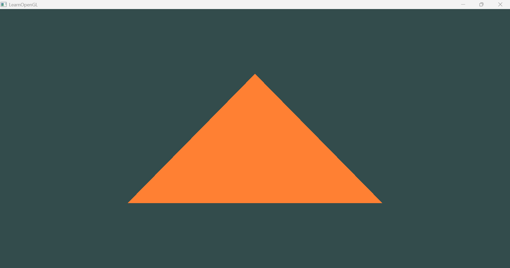
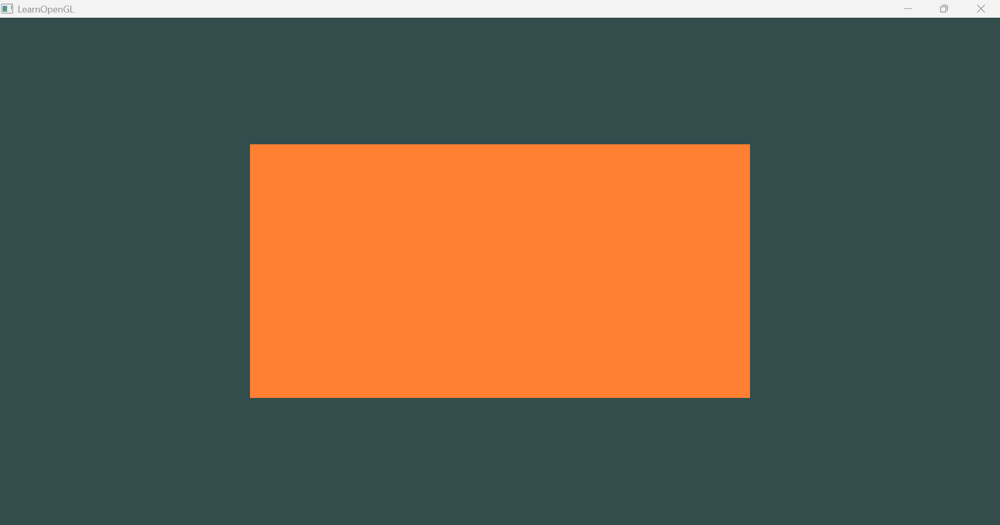
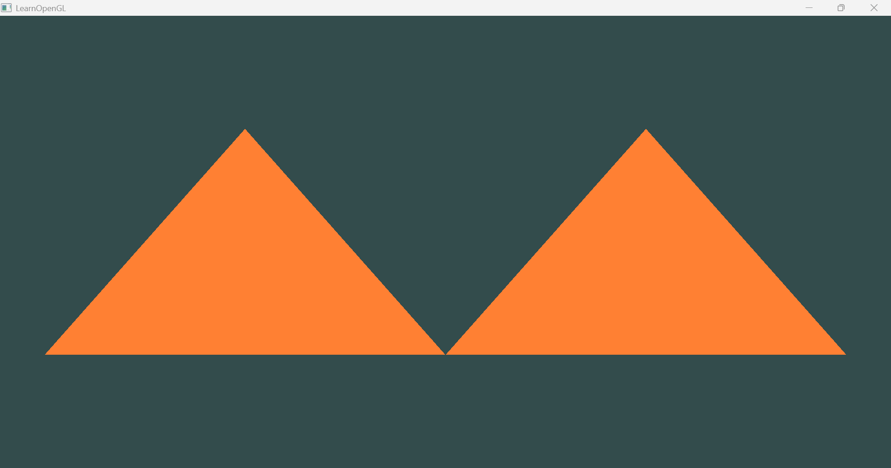
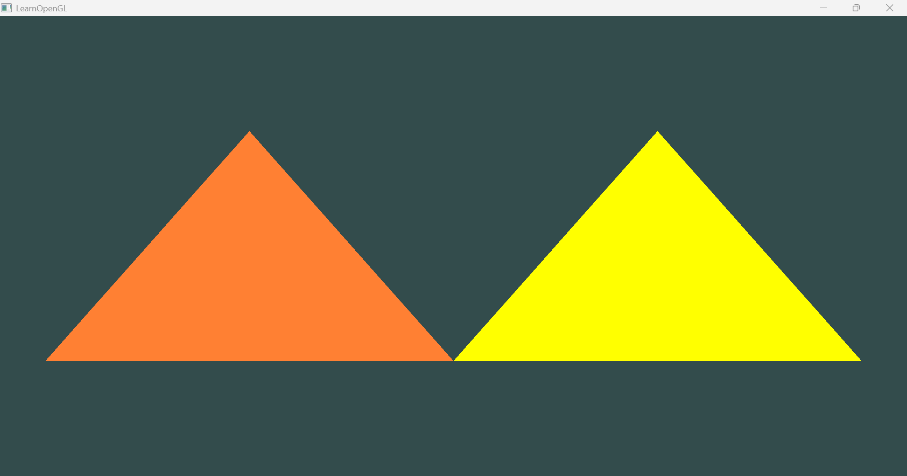
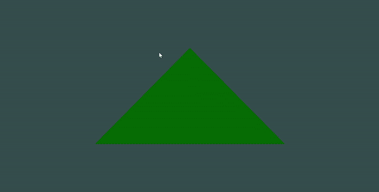
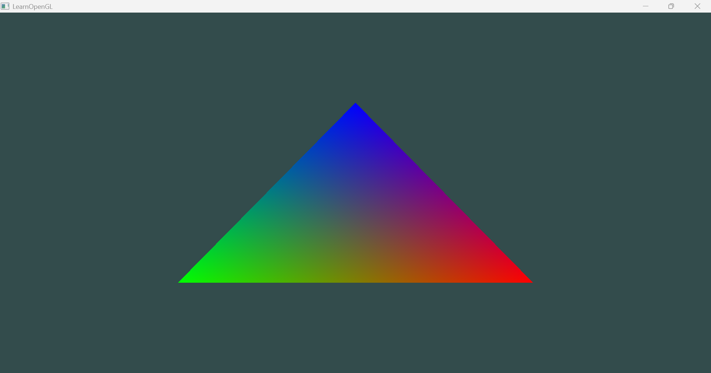
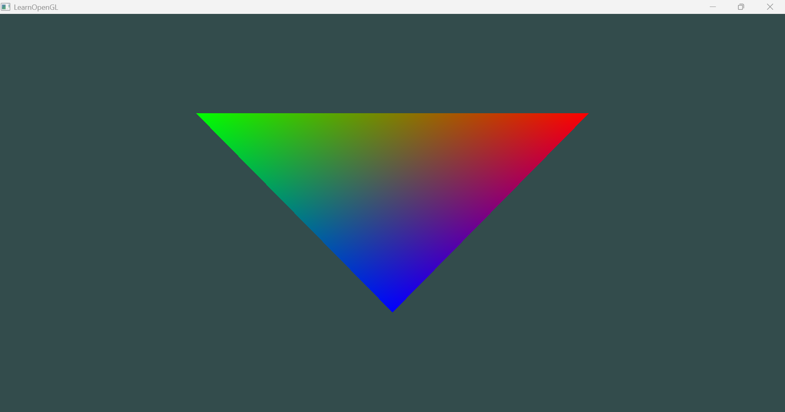
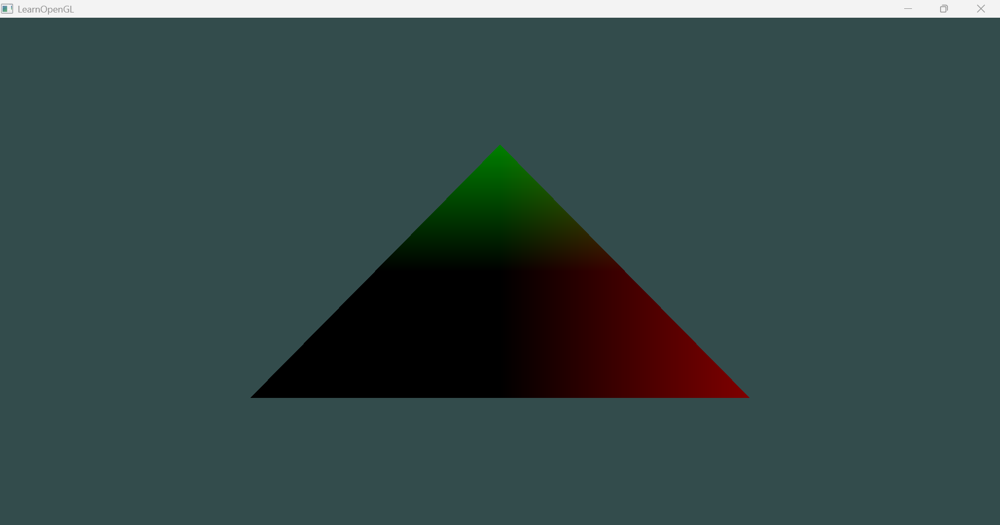

# LearnOpenGL – Hello Triangle & Shaders

My solutions for the **Hello Triangle** and **Shaders** chapters of [LearnOpenGL](https://learnopengl.com/). The repo includes the chapter examples and the exercises, and each one is a small standalone program with its own `main()`.

## Programs

| # | Source file | What it does |
|---|-------------|--------------|
| 01 | `01_hello_triangle.cpp` | Draws a single orange triangle |
| 02 | `02_hello_triangle_indexed.cpp` | Draws a rectangle using an EBO (indexed drawing) |
| 03 | `03_hello_triangle_exercise1_two_triangles_draw_arrays.cpp` | Exercise 1: two triangles with one `glDrawArrays` call |
| 04 | `04_hello_triangle_exercise2_two_triangles_two_vaos.cpp` | Exercise 2: two triangles using two VAOs and two VBOs |
| 05 | `05_hello_triangle_exercise3_two_shader_programs.cpp` | Exercise 3: two shader programs (orange and yellow triangles) |
| 06 | `06_shaders_uniform.cpp` | Animated green color passed through a uniform |
| 07 | `07_shaders_interpolation.cpp` | Per-vertex colors interpolated across the triangle |
| 08 | `08_shaders_exercise1_upside_down_triangle.cpp` | Exercise 1: flips the triangle upside down in the vertex shader |
| 09 | `09_shaders_exercise3_position_as_color.cpp` | Exercise 3: uses the vertex position as the output color |

## Project Structure

```
LearnOpenGL-Task/
├── .vscode/                 # VS Code build and debug configuration
│   ├── launch.json
│   └── tasks.json
├── build/                   # Compiled executables (not tracked by git)
├── dependencies/
│   ├── glad/                # GLAD loader (include/ and src/glad.c)
│   ├── glfw/include/        # GLFW headers
│   └── LearnOpenGL/
│       └── shader_s.h       # Shader helper class
├── screenshoots/            # Output screenshots used in this README
├── src/
│   ├── 01_hello_triangle.cpp
│   ├── ...
│   ├── 09_shaders_exercise3_position_as_color.cpp
│   └── shaders/             # GLSL vertex and fragment shaders
└── README.md
```

## Requirements

- Windows with [MSYS2](https://www.msys2.org/) (UCRT64 environment)
- GCC and GLFW installed from the MSYS2 UCRT64 shell:

```bash
pacman -S mingw-w64-ucrt-x86_64-gcc mingw-w64-ucrt-x86_64-glfw
```

- [Visual Studio Code](https://code.visualstudio.com/) with the C/C++ extension (recommended)
- A GPU and driver with modern OpenGL support

GLAD and the GLFW headers are already included in `dependencies/`. The GLFW library itself (`libglfw3.a`) comes from MSYS2.

## Build and Run

### With VS Code

1. Open the project folder in VS Code.
2. Open any file from `src/`, for example `src/06_shaders_uniform.cpp`.
3. Press `Ctrl+Shift+B` to build, or `F5` to build and debug.

The executable is created in `build/` with the same name as the source file.

### From the command line

Run these commands from the project root, using the MSYS2 UCRT64 shell:

```bash
g++ -std=c++17 -g src/01_hello_triangle.cpp dependencies/glad/src/glad.c \
    -I dependencies/glad/include -I dependencies/LearnOpenGL \
    -o build/01_hello_triangle.exe \
    -lglfw3 -lopengl32 -lgdi32 -luser32 -lshell32 -lwinmm

./build/01_hello_triangle.exe
```

> **Important:** run the executable from the project root, not from inside `build/`. The shaders are loaded using relative paths such as `src/shaders/basic.vs`.

Press `Esc` to close the window.

## Screenshots

### 01 – Hello Triangle



### 02 – Rectangle with EBO



### 03 – Two Triangles (`glDrawArrays`)



### 04 – Two Triangles (Two VAOs)


### 05 – Two Shader Programs



### 06 – Uniform Color



### 07 – Interpolated Colors



### 08 – Upside-Down Triangle



### 09 – Position as Color



## Credits

Based on the tutorials at [learnopengl.com](https://learnopengl.com/) by Joey de Vries.
